<div align="center">

# 🚕 Commutex (SmartTaxi)

**Your smart co-pilot for South African minibus taxi travel.**

Know your fare before you ride, plan multi-stop trips, save your regular routes and chat with an AI commuter assistant — all in one Flutter app.


</div>

---

## 📖 About the app

Commuting by minibus taxi in South Africa often means guessing what a trip will cost, especially when it involves several legs or peak-hour traffic. **Commutex** (published in-app as **SmartTaxi**) takes the guesswork out of it:

- **Instant fare estimates** between popular ranks, townships, suburbs, CBDs and malls in Johannesburg, Pretoria, Cape Town and Durban.
- **Multi-stop trip planning** with drag-to-reorder stops, distance and travel time estimates.
- **Peak-hour awareness** – the app detects rush hour automatically and applies a surge so you see a realistic price.
- **Fare splitting & tips** – split the fare across passengers and add a driver tip.
- **Saved routes** – keep a personal travel library (Home → Work, Visit Gogo, …) with categories, favourites, usage counts and spending totals. Stored on the device, so it works offline.
- **Kaya, your AI co-pilot** – a built-in chat assistant for fares, routes, safety and budgeting. It knows whether it's peak hour right now and (if you allow it) your saved routes, so its answers are personal. Replies are nicely formatted, with copy, regenerate and follow-up suggestions.
- **Share trip results** via WhatsApp.
- **Safety first** – a one-tap SOS sheet that opens your dialer for SAPS (10111), ambulance (10177) or 112 from any cellphone.
- **Rush-hour radar** – the home screen shows whether peak-hour surge pricing is on right now and counts down to the next change.
- **Spending at a glance** – a weekly budget ring and 7-day spend chart on the home screen.
- **Light, dark and system themes**, picked during onboarding and changeable in Settings.

### How fares are calculated

| Component | Value |
|---|---|
| Base fare | R15 |
| Distance | R12 per km |
| Each extra stop | +50% of base fare |
| Peak-hour surge | +30% (mornings and late afternoons) |

> ℹ️ Locations, distances and some dashboard stats currently come from built-in mock data (`lib/data/mock_data.dart`), and sign-in is simulated. The app is a working prototype, not connected to a live taxi network.

---

## 📱 Screenshots

| Onboarding | Sign in / Sign up | Home |
|:---:|:---:|:---:|
| 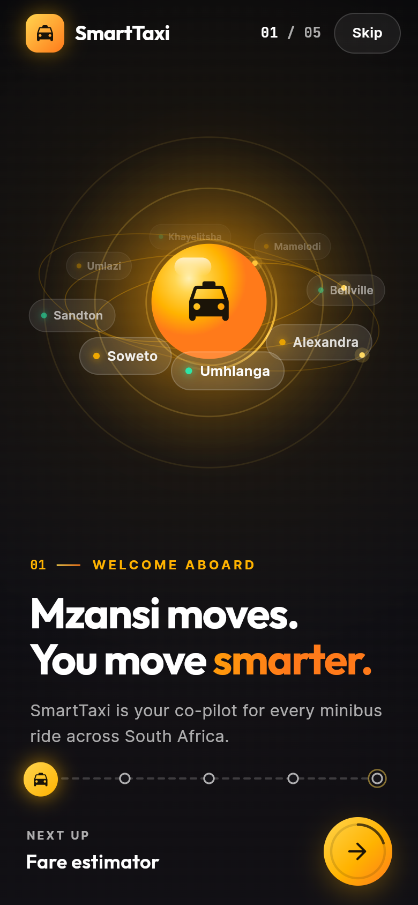 | 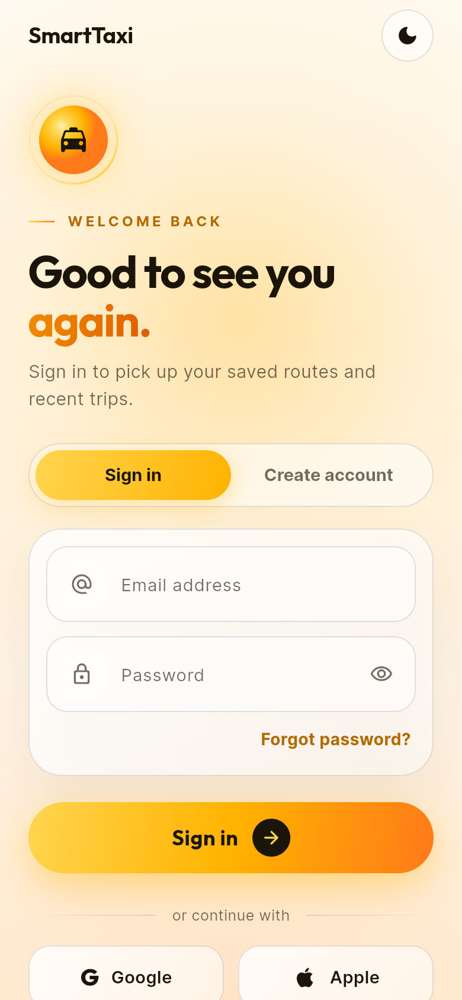 | 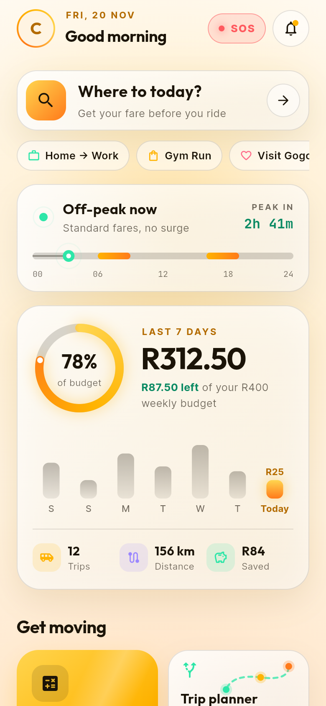 |

| Fare Estimator | Trip Planner | Saved Routes |
|:---:|:---:|:---:|
| 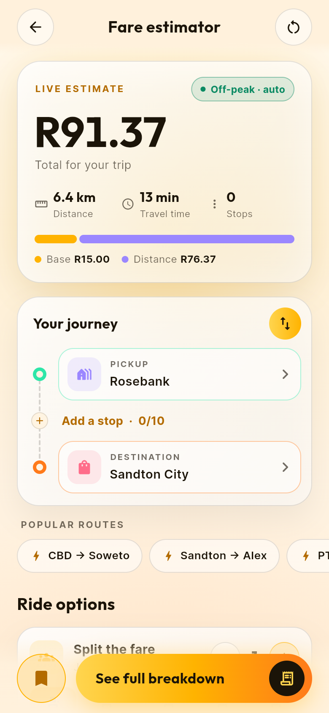 | 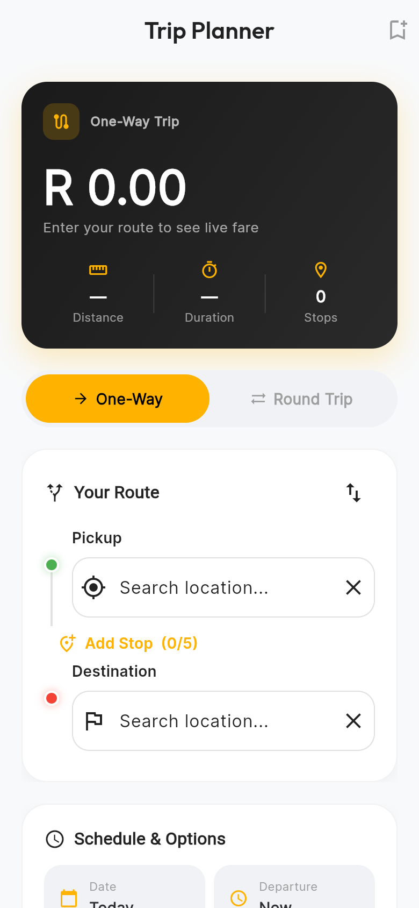 | 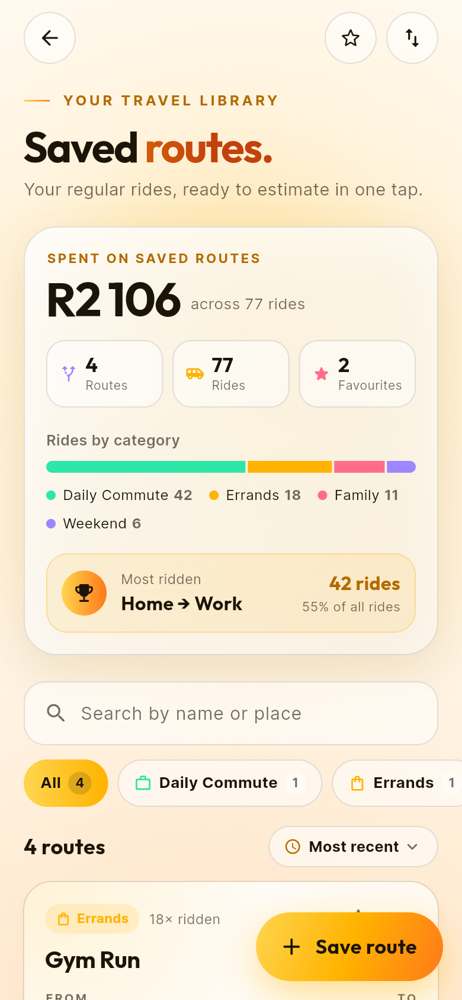 |

| Kaya AI | Settings |
|:---:|:---:|
| 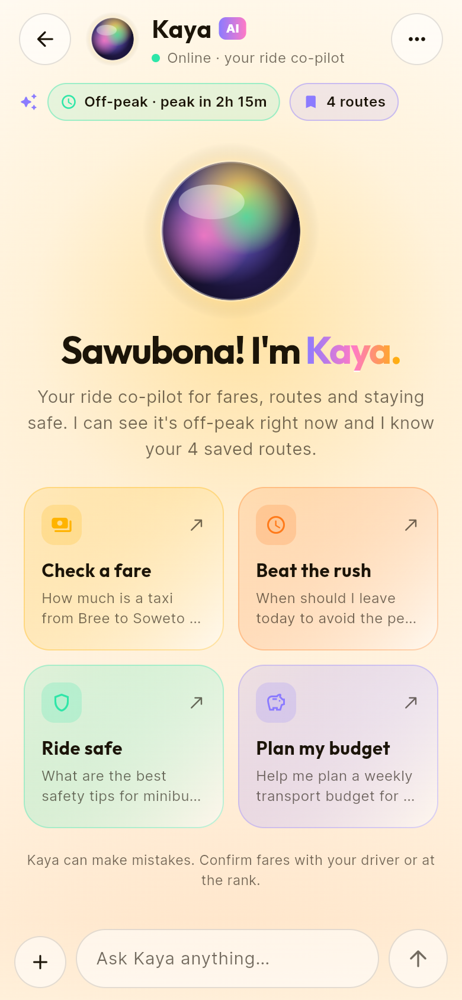 | 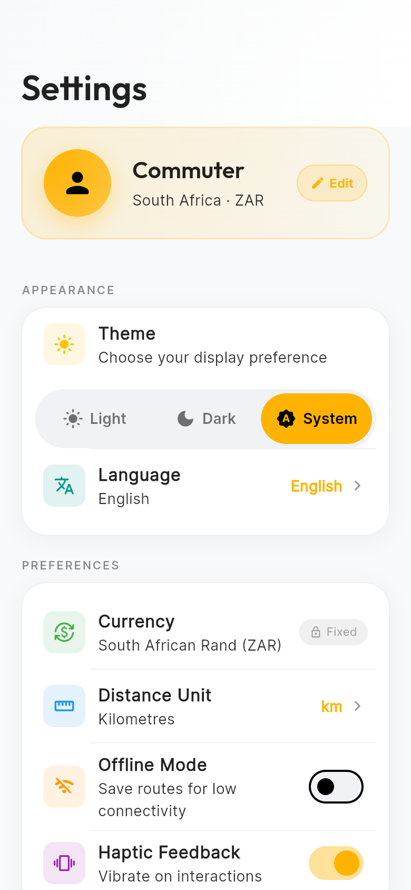 |

### 🌙 Dark mode

| Home | Fare Estimator | Saved Routes | Settings |
|:---:|:---:|:---:|:---:|
| 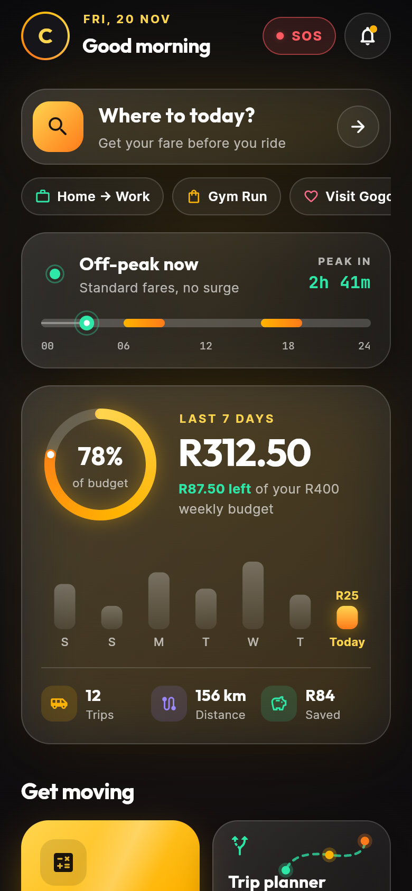 | 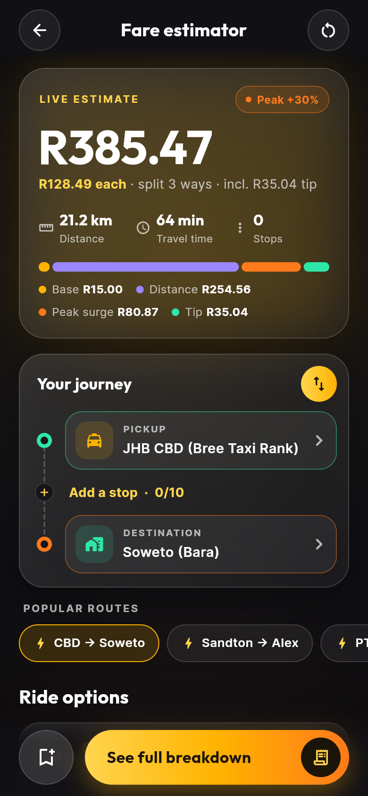 | 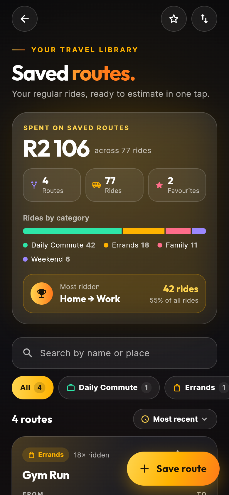 | 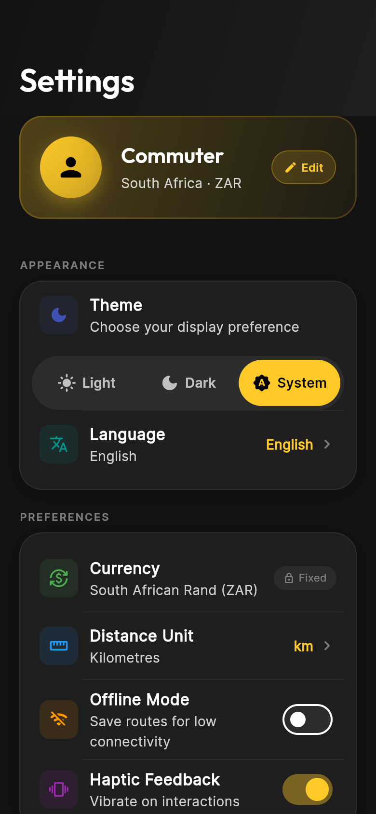 |

---

## 🚀 Getting started

### Prerequisites

- [Flutter SDK](https://docs.flutter.dev/get-started/install) (stable channel, Dart **3.6** or newer)
- [Git](https://git-scm.com/downloads)
- One of the following to run the app:
  - An Android emulator or a physical Android device (Android Studio)
  - An iOS simulator or iPhone (macOS + Xcode)
  - Google Chrome (to run it as a web app)

Check that Flutter is set up correctly:

```bash
flutter doctor
```

### 1. Clone the repository

```bash
git clone https://github.com/Zimako-Dev/Commutex.git
```

```bash
cd Commutex
```

### 2. Install dependencies

```bash
flutter pub get
```

### 3. Run the app

List your available devices:

```bash
flutter devices
```

Run on a connected phone or emulator:

```bash
flutter run
```

Or run it in the browser:

```bash
flutter run -d chrome
```

### 4. (Optional) Enable Kaya, the AI chat

The AI assistant talks to an OpenAI-compatible chat completions endpoint. Pass your endpoint and key at build time — without them the chat replies that the AI service isn't configured, and everything else still works.

```bash
flutter run --dart-define=OPENAI_PROXY_ENDPOINT=https://your-endpoint/v1/chat/completions --dart-define=OPENAI_PROXY_API_KEY=your_api_key
```

> ⚠️ Never commit API keys to the repository.

### Building a release

```bash
flutter build apk --release
```

```bash
flutter build web --release
```

---

## 🗂️ Project structure

```
lib/
├── main.dart                  # App entry point, providers & theming
├── nav.dart                   # go_router routes
├── theme.dart                 # Light & dark Material 3 themes
├── data/
│   ├── models.dart            # Location, TripResult, SavedRoute
│   └── mock_data.dart         # Sample SA locations & fare constants
├── services/
│   ├── fare_service.dart          # Fare & distance calculation
│   ├── saved_routes_service.dart  # Saved routes (shared_preferences)
│   ├── claude_service.dart        # Kaya AI chat client
│   └── theme_provider.dart        # Theme mode state
├── pages/
│   ├── onboarding_page.dart
│   ├── auth_page.dart
│   ├── home_page.dart
│   ├── calculator_page.dart       # Fare Estimator
│   ├── trip_planner_page.dart     # Multi-stop planner
│   ├── result_page.dart           # Fare breakdown & sharing
│   ├── saved_page.dart
│   ├── ai_chat_page.dart
│   └── settings_page.dart
└── widgets/                   # Reusable UI components
```

## 🛠️ Built with

- [Flutter](https://flutter.dev) & Dart
- [provider](https://pub.dev/packages/provider) – state management
- [go_router](https://pub.dev/packages/go_router) – navigation
- [shared_preferences](https://pub.dev/packages/shared_preferences) – local storage
- [flutter_animate](https://pub.dev/packages/flutter_animate) – animations
- [google_fonts](https://pub.dev/packages/google_fonts) – typography
- [http](https://pub.dev/packages/http) & [url_launcher](https://pub.dev/packages/url_launcher)

---

<div align="center">
Made with ❤️ in South Africa by <a href="https://github.com/Zimako-Dev">Zimako-Dev</a>
</div>
